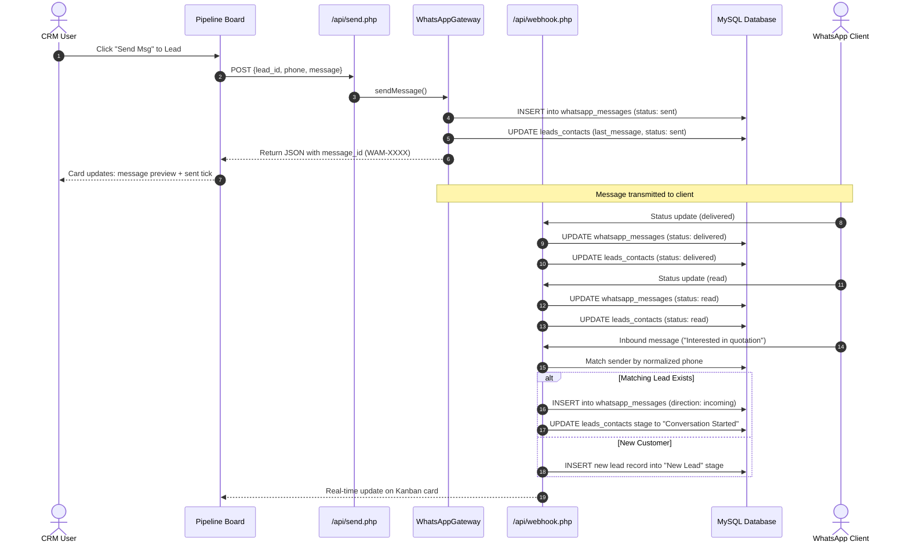

# Technical Architecture & API Specifications

**Project:** WhatsApp Integration with Vtiger CRM  
**Author:** PHP Developer  

---

## 1. System Components

The architecture separates CRM user interactions from webhook handling and database persistence:

```mermaid
graph TD
    User([CRM User]) -->|Browser| UI[Kanban Pipeline UI]
    
    subgraph Frontend Layer
        UI -->|Send Message| SendAPI[/api/send.php]
        UI -->|Update Stage| StageAPI[/api/update_stage.php]
        UI -->|Fetch Chat History| ChatAPI[/api/chat.php]
        UI -->|Test Scenarios| SimulatorUI[Gateway Simulator]
    end

    subgraph Application Layer
        SendAPI --> GatewayService[WhatsAppGateway Service]
        GatewayService --> MessageModel[Message Model]
        GatewayService --> LeadModel[Lead Model]
        
        SimulatorUI -->|HTTP POST| WebhookReceiver[/api/webhook.php]
        
        WebhookReceiver -->|Status Receipts| MessageModel
        WebhookReceiver -->|Inbound Messages| AutoMapper[Phone Mapping Logic]
        AutoMapper -->|Known Number| LeadModel
        AutoMapper -->|Unknown Number| NewLeadCreator[Inbound Lead Creation]
    end

    subgraph Storage Layer
        MessageModel --> DB_Msg[(whatsapp_messages)]
        LeadModel --> DB_Lead[(leads_contacts)]
        LeadModel --> DB_Stage[(pipeline_stages)]
        WebhookReceiver --> DB_Log[(webhook_logs)]
    end
```

---

## 2. Message Lifecycle & Webhook Sequence



---

## 3. Database Design Decisions

1. **`leads_contacts` table:**
   - Stores raw contact phone (`phone`) and cleaned E.164 digits (`normalized_phone`).
   - `normalized_phone` is indexed (`idx_normalized_phone`) so incoming webhook lookup queries run in $O(\log N)$ time rather than table scanning.
   - Includes summary columns (`last_message_text`, `last_message_status`, `last_contacted_at`) updated whenever a message event occurs. This avoids expensive `JOIN` or `GROUP BY` aggregations when rendering the Kanban board.

2. **`whatsapp_messages` table:**
   - Tracks unique message references (`message_id`) with a unique index.
   - Relational foreign key `lead_id` referencing `leads_contacts.id` with `ON DELETE CASCADE`.
   - Direction flag (`outgoing` vs `incoming`) and lifecycle timestamps (`sent_at`, `delivered_at`, `read_at`).

3. **`webhook_logs` table:**
   - Stores raw incoming JSON strings, client IP addresses, and processing statuses (`success`, `failed`, `unmapped`).
   - Essential for debugging payload mismatches or inspecting webhook retries.

---

## 4. Webhook Payload Specifications

### Inbound Message: `POST /api/webhook.php`
```json
{
  "event_type": "incoming_message",
  "sender_number": "+91 98230 12345",
  "recipient_number": "919876500000",
  "message_content": "Hi, please share product pricing.",
  "message_id": "WAM-IN-20261025-01",
  "timestamp": "2026-10-25 15:30:00"
}
```

**Response (`200 OK`):**
```json
{
  "success": true,
  "event": "incoming_message",
  "message_id": "WAM-IN-20261025-01",
  "lead_id": 1,
  "auto_mapped": true,
  "new_lead_created": false,
  "lead_name": "Rahul Sharma"
}
```

### Status Callback: `POST /api/webhook.php`
```json
{
  "event_type": "status_update",
  "message_id": "WAM-20261025104352-c85d02",
  "status": "read"
}
```

**Response (`200 OK`):**
```json
{
  "success": true,
  "event": "status_update",
  "message_id": "WAM-20261025104352-c85d02",
  "status": "read"
}
```

---

## 5. Technical Discussion Points (Interview Preparation)

- **Handling Idempotency:** The webhook receiver checks if `message_id` already exists before inserting. If an external service or network retry delivers the same payload twice, the system returns a `200 OK` without creating duplicate message records.
- **Phone Number Normalization:** In India, phone numbers are entered with variations (`+91`, `91`, leading `0`, spaces, or hyphens). The `normalizePhone()` helper standardizes numbers to pure digits and matches on the last 10 digits as a fallback to guarantee accurate contact mapping.
- **Handling Unknown Inbound Senders:** If an unmapped customer sends an incoming message, rather than dropping it or logging an unhandled error, the system automatically creates a new lead in the `New Lead` stage titled `Inbound +[number]`.
- **Decoupled Gateway:** The `WhatsAppGateway` service uses an Adapter pattern. Switching from this local simulator to a live Meta WhatsApp Cloud API endpoint requires modifying only the `sendMessage` transport method without altering CRM UI or controller logic.
